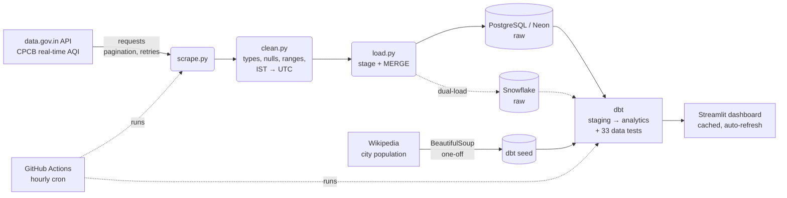

# 🌫️ India Air Quality: Live Data Pipeline & Dashboard

[](https://github.com/Himanshu552003/aqi-pipeline/actions/workflows/hourly_pipeline.yml)

An end-to-end data engineering + analytics project. Every hour it collects real-time air quality
readings from **~500 government monitoring stations across India**, loads them into a cloud data
warehouse, models them with **dbt**, and serves a **live Streamlit dashboard**.

**▶ Live dashboard:** _add your Streamlit Cloud link here_

---

## The problem

India publishes hourly air quality data from the Central Pollution Control Board (CPCB), but only as a
"current snapshot". Yesterday's values are overwritten. So simple questions have no ready answer:
*Which cities were most polluted this week? At what hour of the day is the air worst? How many people
live in cities with "Poor" air right now?*

This project captures every hourly snapshot, so history builds up, and turns it into those answers.

## Architecture



## Tech stack

| Layer | Tools |
|---|---|
| Ingestion | Python, `requests` (REST API with pagination / retries / backoff), `BeautifulSoup` (HTML scraping) |
| Validation | `pandas`: type casting, null & range checks, timezone conversion, de-duplication |
| Storage | **PostgreSQL** (Neon, serverless) and **Snowflake**, both accessed through **SQLAlchemy** |
| Transformation | **dbt Core**: staging & analytics layers, incremental model, seeds, macros, generic + custom tests |
| Orchestration | **GitHub Actions**: hourly cron, secrets management |
| Visualisation | **Streamlit** + **Plotly**: map, KPIs, trends, heatmap |
| Testing | `pytest` (17 unit tests, network mocked) + dbt data tests |

## Data model

```
raw.aqi_readings                 one row per station × pollutant × hour (as delivered by the API)
  └─ staging.stg_aqi_readings    renamed, de-duplicated, city names standardised, IST date/hour
       └─ analytics.fct_station_aqi           AQI per station-hour (incremental)
            ├─ analytics.fct_city_aqi_hourly  city × hour
            │    ├─ analytics.city_ranking_24h         most / least polluted cities
            │    └─ analytics.city_hour_of_day_profile peak pollution hour per city
            ├─ analytics.fct_city_aqi_daily   city × day
            ├─ analytics.city_latest_aqi      current AQI per city (+ population)
            └─ analytics.aqi_category_distribution  Good … Severe share per city
raw.city_population (seed, scraped from Wikipedia) ─┘
```

**How AQI is calculated (CPCB method):** the API gives a sub-index (0–500) for each pollutant (PM2.5,
PM10, NO₂, SO₂, CO, O₃, NH₃). A station's AQI is the **highest** sub-index. That pollutant is the
*dominant pollutant*. The AQI only counts as valid when **at least 3 pollutants, including PM2.5 or
PM10**, are reported. Categories: Good (0–50), Satisfactory (51–100), Moderate (101–200),
Poor (201–300), Very Poor (301–400), Severe (401–500).

## Key design decisions

- **Idempotent loads.**
  - Each run bulk-inserts the snapshot into a stage table, then runs one SQL `MERGE` on the natural key *(station, pollutant, reading time)*.
  - New readings are inserted, revised readings are updated, and unchanged ones are skipped.
  - Running the pipeline twice never creates duplicates. This was verified: the second run inserted 0 rows.
- **Database-agnostic.**
  - One setting (`DB_TYPE=postgres|snowflake`) picks the database for the dashboard and dbt, through a single `db_connection.py`.
  - The SQL is written to run on both databases: standard `MERGE`, `IS DISTINCT FROM`, dbt cross-database macros (`dateadd`, `date_trunc`, `hash`), and an `adapter.dispatch` macro where the two dialects differ.
- **Dual-load.**
  - The loader writes raw data to every database listed in `LOAD_TARGETS`.
  - Postgres always keeps the full history, so when the Snowflake trial ends you switch one setting, with no data migration.
- **Layered warehouse** (`raw → staging → analytics`), as used in industry.
  - Raw stays close to the source, so the analytics layer can always be rebuilt.
  - Staging also de-duplicates, because Snowflake does not enforce primary keys.
- **Incremental modelling.** `fct_station_aqi` only re-processes the last 6 hours each run (new hours plus any late corrections) instead of rebuilding all history.
- **Timezones handled explicitly.** The source sends IST without a timezone marker. Storage is in UTC, and IST is kept for display and hour-of-day analysis.
- **Resilient, polite ingestion.**
  - Timeouts and exponential backoff on 5xx/timeouts.
  - No retry on 4xx errors (bad key or URL).
  - A User-Agent header and rate limiting between pages.
  - The API key is never written to logs.
- **Data quality as code.** 33 dbt tests: uniqueness, not-null, accepted values, a custom `value_between` test for AQI range, and source freshness alerts if the loader stops.
- **Secrets never committed.** `.env` locally (git-ignored), GitHub Secrets in CI, Streamlit secrets in production.

## Dashboard

- KPI cards: the most polluted and the cleanest city right now, national average, and the number of people living in cities at "Poor" or worse.
- Map of India coloured by the official CPCB AQI categories.
- 24-hour ranking of the most polluted cities.
- Hourly trend lines for the cities you choose.
- Hour-of-day heatmap that shows when the air is worst.
- Category distribution per city.
- Data cached with a 10-minute TTL, and the page auto-refreshes.

_Screenshots: add `docs/dashboard.png` once deployed._

## Key insights

_To be filled in after a few weeks of collected data, e.g. most polluted cities, the typical peak
pollution hour, and the share of hours with "Poor" or worse air._

## Run it yourself

See **[INSTRUCTIONS.md](INSTRUCTIONS.md)** for the full setup: local run, GitHub Actions, Streamlit deploy, Snowflake.

```bash
pip install -r requirements.txt
cp .env.example .env              # fill in your keys
python -m scraper.pipeline        # extract + load
python run_dbt.py build           # transform + test
streamlit run dashboard/app.py    # dashboard
```

## Project structure

```
├── scraper/
│   ├── scrape.py              # data.gov.in API client: pagination, retries, rate limiting
│   ├── scrape_population.py   # Wikipedia HTML scraper -> dbt seed
│   ├── clean.py               # validation: types, nulls, ranges, IST -> UTC, de-dup
│   ├── load.py                # idempotent stage + MERGE, dual-load
│   ├── db_connection.py       # DB_TYPE switch -> SQLAlchemy engine
│   └── pipeline.py            # scrape -> clean -> load
├── sql/                       # raw table DDL (portable), Snowflake setup
├── dbt_project/               # dbt models, seeds, macros, tests, profiles (env vars only)
├── dashboard/app.py           # Streamlit app
├── tests/                     # pytest unit tests
├── run_dbt.py                 # runs dbt with .env loaded
└── .github/workflows/         # hourly pipeline
```

## Limitations & next steps

- The data.gov.in API is sometimes slow or down (502s). Failed hours are skipped, and the next run continues.
- Neon's free tier has limited storage. For long-term history, add a retention job for the raw layer (the incremental `fct_station_aqi` keeps the hourly history in a compact form).
- Possible next steps: alerting when a city turns "Severe", forecasting next-day AQI, and adding weather data to explain pollution peaks.

## Data sources & licences

- Air quality: **Central Pollution Control Board (CPCB)**, *Real time Air Quality Index from various locations*, via [data.gov.in](https://data.gov.in), under the [Government Open Data License – India](https://data.gov.in/government-open-data-license-india).
- City population: [Wikipedia: List of cities in India by population](https://en.wikipedia.org/wiki/List_of_cities_in_India_by_population), CC BY-SA 4.0 (Census of India 2011).
